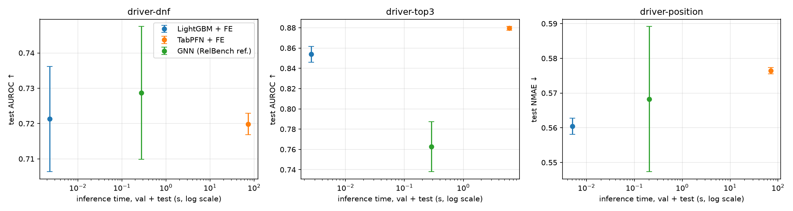
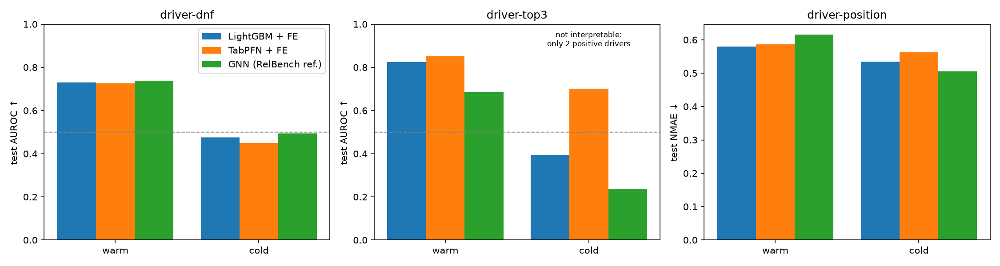

# rel-f1-bench: feature engineering vs relational deep learning on RelBench rel-f1

**Question.** On a temporal relational database, what does relational deep learning actually bring over good feature engineering, and at what cost?

I compare three approaches on the three driver tasks of [RelBench](https://relbench.stanford.edu) `rel-f1`, under exactly the same protocol:

- **LightGBM** on hand-crafted temporal features (SQL joins and aggregates over the driver's past),
- **TabPFN**, a tabular foundation model, on the same features, with no tuning,
- the **reference RelBench GNN** (heterogeneous GraphSAGE on the raw database).

## TL;DR

- **Feature engineering matches or beats the reference GNN.** On `driver-top3`, TabPFN reaches 0.880 AUROC and LightGBM 0.854, against 0.763 for the GNN. On `driver-dnf` and `driver-position`, the three approaches are on par.
- **TabPFN is the most stable model and needs no tuning**, but its inference is three to four orders of magnitude slower than LightGBM (6 to 73 s against a few milliseconds).
- **The official test set cannot rank these methods.** No difference between them is statistically significant: `driver-top3` has only 14 drivers with a positive label, 28 to 43 % of test rows are drivers with no history, and test-time information is almost two years old (vs 11 days in validation).

## Setup

`rel-f1` is the Formula 1 database (1950 to 2009 here): 9 tables such as `drivers`, `results`, `qualifying`, `standings` and `constructors`. Each task predicts something about a driver at a given date:

| Task | Target | Metric |
|---|---|---|
| `driver-dnf` | will the driver fail to finish a race in the next month? | AUROC ↑ |
| `driver-top3` | will the driver qualify in the top 3 in the next month? | AUROC ↑ |
| `driver-position` | average finishing position over the next two months | NMAE ↓ (MAE divided by the train std, 7.026) |

Official temporal splits: train before 2005, validation 2005 to 2009, test from 2010. At test time the database stops in November 2009.

## Methods

| | Input | Training | Selection on validation |
|---|---|---|---|
| **LightGBM + FE** | 34 temporal features: career and recent form (last 5 and 10 races), qualifying history, championship standing, strength of the last team | 50 Optuna trials | hyperparameters and early stopping |
| **TabPFN + FE** | same 34 features | none: the train table is the in-context set | none (validation never used) |
| **GNN** | raw database as a graph (rows = nodes, foreign keys = edges) | official RelBench example (2 layers, 128 channels, 10 epochs) | best epoch |

**Protocol, identical for every method:**

- **No leakage.** Every feature is computed with a strict per-row cutoff (`date < t` on every join). An automated test (`tests/test_leakage.py`) recomputes features on a database truncated at each row's own timestamp and checks they are identical.
- **Official evaluation.** Test predictions are scored through RelBench's leaderboard path (`write_prediction_table` then `evaluate_task`).
- **10 seeds** per method, and a **paired driver-level bootstrap** (1,000 resamples): all methods are scored on the same resampled drivers, because rows of one driver are strongly correlated.
- **No choice made on test scores.** The GNN uses the official config, TabPFN its defaults.

## Results

### Main table (test, mean ± std over 10 seeds)

| Task | LightGBM + FE | TabPFN + FE | GNN (reproduced) | GNN (published) |
|---|---|---|---|---|
| `driver-dnf` (AUROC ↑) | 0.721 ± 0.015 | 0.720 ± 0.003 | **0.729 ± 0.019** | 0.726 |
| `driver-top3` (AUROC ↑) | 0.854 ± 0.008 | **0.880 ± 0.002** | 0.763 ± 0.025 | 0.755 |
| `driver-position` (NMAE ↓) | **0.560 ± 0.002** | 0.576 ± 0.001 | 0.568 ± 0.021 | 0.573 |

The reproduced GNN is within one standard deviation of the published scores on all three tasks.

### Are the differences significant?

Paired bootstrap on test, difference with LightGBM (95 % CI):

| Task | TabPFN − LightGBM | GNN − LightGBM |
|---|---|---|
| `driver-dnf` | −0.001 [−0.023, +0.019] | +0.009 [−0.044, +0.069] |
| `driver-top3` | +0.027 [−0.011, +0.073] | −0.077 [−0.170, +0.044] |
| `driver-position` | +0.016 [−0.005, +0.038] | +0.008 [−0.039, +0.059] |

Every interval contains 0. (For `driver-position` lower is better, so a positive difference means worse than LightGBM.)

The only significant effect in the whole study is an ablation: adding `days_since_last_race` to the LightGBM features **hurts** `driver-dnf` (−0.017 [−0.039, −0.002]). This feature has a median of 12 days in train but 661 days in test, so the model extrapolates.

### Cost



| | Training (per seed) | Tuning (once) | Inference (val + test) | Peak GPU memory | Parameters |
|---|---|---|---|---|---|
| LightGBM + FE | 0.04 – 0.28 s | 3 – 14 s | 2 – 5 ms | CPU only | — |
| TabPFN + FE | 0.3 – 0.5 s | — | 6 s (top3) – 71 s (position) – 73 s (dnf) | 3.6 – 6.2 GB | pretrained |
| GNN | 5 – 21 s | — | 0.2 – 0.3 s | 2.3 – 3.3 GB | 5.1 M |

TabPFN moves the cost of learning to inference: it grows with the size of the context (1,353 train rows for top3, 7,453 for position, 11,411 for dnf). All runs on a single RTX 4070 (12 GB).

### The test set

| Task | Rows | Drivers | Cold drivers | Cold rows | Drivers with a positive (warm / cold) |
|---|---|---|---|---|---|
| `driver-dnf` | 702 | 42 | 17 | 28 % | 42 (25 / 17) |
| `driver-top3` | 726 | 42 | 17 | 28 % | **14 (12 / 2)** |
| `driver-position` | 760 | 56 | 31 | 43 % | — |

*Warm* drivers raced before the test cutoff; *cold* drivers debut after it, so they have no history at all. The median time since a driver's last known race is 11 to 15 days in train and validation, but **661 days** (dnf, top3) and **1,043 days** (position) in test.



On warm drivers, the top3 gap is larger: 0.852 (TabPFN) and 0.825 (LightGBM) against 0.686 (GNN). On cold drivers, every method is close to chance on dnf, and the GNN is the best on position (0.505 vs 0.535 for LightGBM).

### GNN ablations (test)

| Variant | dnf | top3 | position | position (val) |
|---|---|---|---|---|
| reference (10 epochs, uniform neighbour sampling) | 0.729 | 0.763 | 0.568 | 0.457 |
| 20 epochs | 0.739 | 0.784 | 0.598 | 0.446 |
| 20 epochs + most recent neighbours | 0.719 | 0.765 | 0.620 | 0.446 |

None of these variants closes the gap with feature engineering on top3.

## Analysis

Part of the result was expected: TabPFN is strongest when training data is scarce (1,353 rows for top3). But it goes against RelBench's headline message that relational deep learning outperforms tabular approaches. Several causes, beyond test-set size, may explain it:

1. **The published tabular baseline is weak.** RelBench's LightGBM only uses the columns of the driver table, without joins, and reports 0.739 on top3. With multi-table temporal aggregates, LightGBM reaches 0.854. The gain comes from the features, not from the model.
2. **The signal is mostly autoregressive.** Predicting a top-3 qualification mostly means looking at the driver's recent qualifications. The features encode this label history directly, while the GNN, which never sees past labels, has to rebuild it from raw rows. Sampling the most recent neighbours instead of uniform ones does not help (0.765 vs 0.763 on top3), so diluted recent history is not the explanation.
3. **The schema is small and driver-centred.** Useful information sits one or two hops from the driver, which leaves little deep relational structure that a GNN could exploit better than a join.
4. **The GNN is oversized for the data.** 5.1 M parameters for about 1,400 training rows on top3 explain its large variance across seeds (std 0.025), whereas TabPFN's pretrained prior keeps it stable (std 0.002).
5. **The test set is shifted in ways validation does not show.** Information is about two years old, a gap never seen in training, which puts the GNN's relative-time encoding out of distribution; and 28 to 43 % of rows have no history, hence no neighbours in the graph. Validation can mislead: on position, training the GNN for 20 epochs improves validation (0.457 → 0.446) but degrades test (0.568 → 0.598), entirely through cold drivers (0.505 → 0.579, warm drivers unchanged at 0.61). This effect is specific to position: on dnf and top3, 20 epochs also improves test.

A last, untested point: RelBench's automatic column typing treats the race status code, which precisely defines a DNF, as numerical. This may handicap the GNN on `driver-dnf`.

These are hypotheses, not conclusions. What this study does **not** show: that feature engineering beats GNNs in general (better architectures such as RelGNN report 0.857 on top3), that TabPFN is the best model (its lead on top3 is not significant), or under which conditions relational models win.

## Limitations and future work

- **Small test set**: one temporal split, 42 to 56 drivers. A rolling-origin backtest would give much more statistical power and isolate the effect of stale information.
- **No GNN tuning** beyond two ablations: the reference config is used on purpose, as published.
- **Past labels as GNN input**, to test hypothesis 2 directly.
- **Relational foundation models** (e.g. a Relational Transformer) in zero-shot on the same protocol.
- **Faster TabPFN inference**, for example by caching the encoded context across predictions.

## Reproduce

Requirements: Linux (or WSL2), an NVIDIA GPU with CUDA 12.8 drivers, [uv](https://docs.astral.sh/uv/), and a TabPFN token (the weights are under a non-commercial license).

```bash
git clone https://github.com/MaelKri/rel-f1-bench.git && cd rel-f1-bench
uv sync                                   # Python 3.12, PyTorch 2.9 (cu128), pinned in uv.lock
printf "TABPFN_TOKEN=<your token>\nTABPFN_NO_BROWSER=1\n" > .env

uv run pytest                             # leakage test (downloads rel-f1 on first run)

uv run python scripts/run.py configs/lgbm.yaml
uv run python scripts/run.py configs/lgbm_staleness.yaml
uv run --env-file .env python scripts/run.py configs/tabpfn.yaml
uv run python scripts/run.py configs/gnn.yaml
uv run python scripts/run.py configs/gnn_e20.yaml
uv run python scripts/run.py configs/gnn_e20_last.yaml

uv run python scripts/analyze.py          # tables in results/summary.txt, figures in results/figures/
```

Each run appends one line to `results/runs.jsonl` (scores, confidence interval, cost, config, git commit). The runs behind this README are committed there, and `results/summary.txt` holds every number quoted above.

LightGBM reproduces exactly, and TabPFN up to GPU rounding. GNN runs are not bit-reproducible on GPU (non-deterministic scatter operations), so expect the GNN means to move within seed noise.

## Repository layout

```
configs/                one YAML per experiment (method, seeds, hyperparameters)
src/rel_f1_bench/
  data.py               dataset and task loading
  features.py           SQL features with a strict per-row cutoff, and the leakage check
  models/               lgbm.py, tabpfn.py, gnn.py, relbench_nn.py (RelBench model code)
  evaluation.py         shared evaluation: val, official test, cost, results/runs.jsonl
  stats.py              driver-level bootstraps, warm/cold split
scripts/run.py          runs one config: every task and seed
scripts/analyze.py      tables and figures from results/runs.jsonl
tests/test_leakage.py   leakage test on the real data
```

## Acknowledgements and licenses

- Code in this repository: MIT.
- [RelBench](https://github.com/snap-stanford/relbench) (Apache-2.0): dataset, tasks, evaluation, and the GNN example code adapted in `src/rel_f1_bench/models/relbench_nn.py` and `gnn.py` (commit `07ec0ce`).
- [TabPFN](https://github.com/PriorLabs/TabPFN) 9.2.0 with the TabPFN-3.5 weights, under Prior Labs' non-commercial license.
- The `rel-f1` data is distributed by RelBench under CC-BY-4.0.
